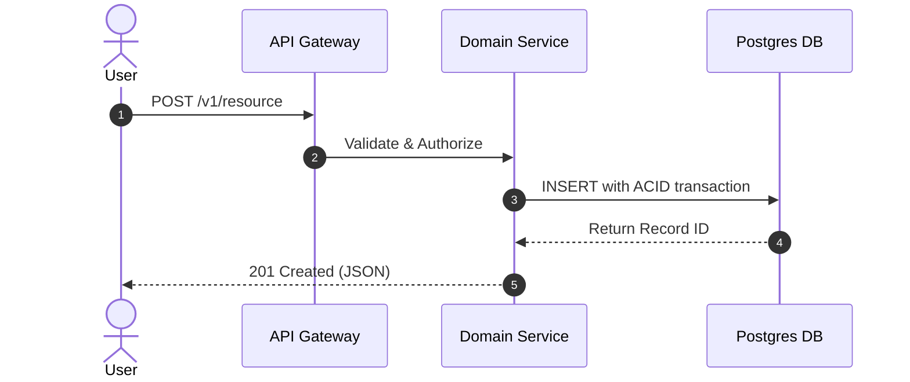

# Spec-Driven Development (SDD) Skill

Use this skill whenever planning, architecting, or initiating a non-trivial feature, new service, database migration, or multi-component refactor.

---

## 1. The Core Philosophy
```
┌────────────────────────────────────────────────────────┐
│            CODE IS EXPENSIVE. SPECS ARE CHEAP.         │
├────────────────────────────────────────────────────────┤
│ Writing code before defining exact requirements leads   │
│ to rework, misaligned architectures, and phantom bugs. │
│ NO non-trivial implementation code may be authored     │
│ until a formal /spec has been validated and signed off.│
└────────────────────────────────────────────────────────┘
```

SDD decouples the **what** and **why** from the **how**. It ensures the developer and agent share an identical mental model before touching disk or modifying ASTs.

---

## 2. The 5-Axis Socratic Interview Protocol

When presented with ambiguous, high-level requests (e.g. *"add team billing"* or *"support markdown exports"*), do not immediately start coding. Conduct a structured Socratic inquiry across these 5 dimensions:

1. **User Persona & Critical Jobs-to-be-Done:**
   - Who uses this feature, and what is their exact workflow?
   - What is the primary success outcome from the user's perspective?
2. **Data Model & Invariants:**
   - What entities, relational foreign keys, or document structures are introduced or mutated?
   - What state transitions are valid, and which must be strictly forbidden?
3. **Edge Cases & Failure Modes:**
   - What happens on network disconnects, invalid payloads, missing permissions, or concurrent writes?
   - What are the fallback and retry semantics?
4. **Performance & Scalability SLAs:**
   - What are the throughput, latency, or payload size limits (e.g., 50ms query time, 10MB upload limit)?
5. **Security, Auth & Compliance:**
   - Who is authorized to read/write this resource?
   - Are PII, secrets, or financial transactions involved?

---

## 3. The `/spec` Command Workflow

```
[1. User Request] ──> [2. Socratic Interview] ──> [3. Formal /spec PRD] ──> [4. Gate Sign-off] ──> [5. TDD Execution]
```

### The Standard `/spec` Schema (`SPEC.md` or PRD format)
When generating a specification, use this precise blueprint:

```markdown
# Technical Specification: [Feature Name]

## 1. Executive Summary & Problem Statement
- **Context:** [Why does this need to be built?]
- **Goals:** [Measurable target outcomes]
- **Non-Goals:** [What are we explicitly NOT building in this iteration?]

## 2. Architecture & Data Flow


## 3. Interface & Contract Definitions
### API Endpoint / Function Signature
```typescript
interface CreateTeamPayload {
  name: string;
  tier: 'free' | 'pro' | 'enterprise';
  billingEmail: string;
}

interface TeamResponse {
  id: string;
  slug: string;
  createdAt: string;
}
```

### Database Schema / Migrations
```sql
CREATE TABLE teams (
    id UUID PRIMARY KEY DEFAULT gen_random_uuid(),
    name VARCHAR(255) NOT NULL,
    tier VARCHAR(50) DEFAULT 'free',
    billing_email VARCHAR(255) NOT NULL,
    created_at TIMESTAMPTZ DEFAULT NOW()
);
```

## 4. Edge Case & Failure Matrix
| Scenario | Condition | System Behavior | HTTP / Return Code |
| :--- | :--- | :--- | :--- |
| Duplicate Name | Team name exists in tenant | Reject with user message | 409 Conflict |
| Invalid Email | Non-RFC format | Reject prior to DB hit | 422 Unprocessable |
| Payment Fail | Webhook fails charge | Downgrade to Free tier | 200 OK (Event Handled)|

## 5. Acceptance Criteria (Given / When / Then)
- **Scenario 1:** Successful Creation
  - *Given* an authenticated admin with valid card on file
  - *When* submitting `POST /v1/teams` with valid payload
  - *Then* return 201 and persist team record in database.
- **Scenario 2:** Unauthorized User
  - *Given* an anonymous visitor
  - *When* attempting `POST /v1/teams`
  - *Then* return 401 Unauthorized with standard error envelope.

## 6. Implementation Task Breakdown
1. [ ] Create database migration and Prisma schema update.
2. [ ] Write failing integration test for `/v1/teams` endpoint.
3. [ ] Implement validation middleware and route handler.
4. [ ] Wire frontend mutation hook and toast notifications.
```

---

## 4. Scope Creep Defense & Gate Sign-off

- **Hard Enforcement:** Never proceed to implementation while the user or reviewer expresses doubt or ambiguity on the spec.
- **Change Control:** If during development a new requirement emerges (e.g. *"we also need Slack alerts"*), update `SPEC.md` first, record the tradeoff, and obtain confirmation before modifying code.
